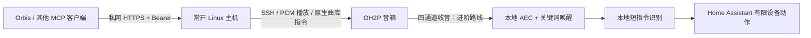

# Xiaomi OH2P 音箱：刷机、连接 AI 与 MCP

把 Xiaomi 智能音箱 Pro（OH2P）作为 AI 的实体声音出口：通过家庭 Wi-Fi 播报，自定义 TTS 音色，调用原厂曲库点歌、暂停、继续。另附本地唤醒、语音识别与音乐干扰处理的实现说明。

本仓库单独维护，因为音箱涉及固件和音频链路，与普通米家灯/风扇接入不同。摄像头和一般家电见 [米家 HomeMCP 教程](https://github.com/AZHi-xinxin/xiaomi-ha-mcp-tutorial)。

## 按顺序做

1. [看清设备分工和准备材料](docs/01-prepare.md)。
2. [核验固件与分区，再刷写](docs/02-flash.md)。已经能 SSH 的音箱跳过刷机。
3. [建立 Wi-Fi SSH，部署播报/音乐 MCP](docs/03-connect-mcp.md)。
4. [进阶：自定义唤醒、本地识别、Orbis 对话与回声处理](docs/04-voice-pipeline.md)。
5. [故障表与验收单](docs/05-troubleshooting.md)。

## 已验证与适用边界

- 实机是 **OH2P、1.62.2**，保留原厂小爱功能。这里没有测过所有小爱机型，不要按中文商品名推定兼容。
- 刷写后通过 Wi-Fi SSH 读取完整镜像长度，哈希与候选一致；原厂另一系统槽位保留。未做破坏性回滚演练。
- 原曲库点歌、暂停/继续、Orbis 发现并调用工具已真人通过。歌曲实际受账号/版权限制，测试曲有约 60 秒返回，不能承诺解锁完整版。
- 自定义唤醒和自然说法控制家电、大音量播放时唤醒、断电搬回原位后回应已真人通过；长期歌词误唤醒率尚未完成系统测量。
- 2026-10-31 已恢复一次监听器因启动次数限制而停住的故障，并再次通过真人唤醒验收。现补充 [30 秒重连配置与恢复步骤](docs/04-voice-pipeline.md#后台运行和验收)，供已有监听器部署采用。
- **本仓库可运行示例是 MCP 播报和音乐入口，加 AEC 模块**。第 4 篇解释实际语音服务怎么组装，不包含现有家庭的完整常驻监听器、个性化回复表或手机绑定文件，不是“一条命令复制整套私人助手”。通用版全自动语音安装器仍未提供。
- 公开示例经过隔离测试，尚未在另一只全新音箱上重复刷机和从零复装。

## 文件

- `src/server.py`：`speaker_say`、`speaker_music` 两项 MCP 工具。
- `src/music_control.py`：原生曲库、状态核验、失败不自动重放。
- `src/speaker_voice.py`：TTS → 本地解码 → SSH 播放。
- `src/speaker_aec.py`：四通道输入的 SpeexDSP 回声抵消，无云端音频。
- `examples/`：SSH、私有配置模板和 systemd 单元。
- `tests/`：离线逻辑/合成 DSP 回归，不会操作实体音箱。

## 来源和许可

刷机基础来自 [Open-XiaoAI](https://github.com/idootop/open-xiaoai)，构建材料和授权以其仓库为准。本仓库不打包厂商固件、USB 驱动、第三方模型或私人密钥。原创文档和示例使用 [MIT](LICENSE)，第三方项目各有自己的许可证。

[测试记录与复测方法](docs/verification.md)
